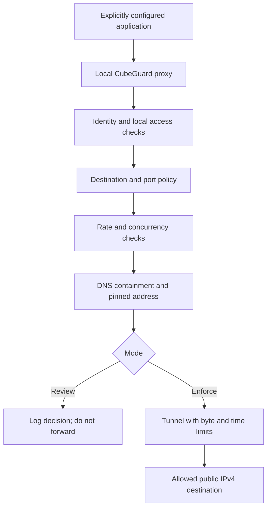

# CubeGuard prototype

A dependency-free Node.js local CONNECT proxy implementing six security checks, plus an optional Windows Firewall script. This is a working experimental prototype, not a production firewall, quantum technology, malware scanner, or replacement for Windows Firewall.

**Free for personal, noncommercial use.** Read the [license](LICENSE) for permissions, including noncommercial forks and redistribution. Commercial and organizational operational use require separate written permission from the applicable copyright holders. This is source-available software, not an OSI-approved open-source project.

## What it is for and why

CubeGuard explores a simple idea: put several independent checks around an individual protected endpoint, like the faces of a cube. A successful login should not automatically mean unlimited access. Different checks can constrain who connects, where a connection goes, how it behaves and how much data it carries.

The longer-term concept is one protective gateway per device. For equipment such as refrigeration controllers, a future implementation could validate commands locally and work alongside independent physical safety controls. That functionality is a design goal, not a feature of this release. This repository does not contain a refrigeration gateway, controller integration, safety cutoff or hardware device attestation.

The current release is for personal learning, local experiments and review of an explicit proxy's policy decisions. It provides:

- Shared-secret authentication and a loopback-only listener.
- Destination domain allow/block rules and allowed destination ports.
- DNS checks that reject private/reserved destinations and pin a validated IPv4 address.
- Request-rate, simultaneous-connection, session-duration, idle-time and data limits.
- Bounded decision logs, a no-forwarding review mode and an optional Windows IP-block script.
- Automated tests using local fake upstreams, without real equipment or internet targets.

Multiple checks provide useful constraints only when they cannot be bypassed. Applications may connect directly instead of using this proxy, and encrypted commands inside a permitted tunnel are not inspected. All six checks currently share one process and policy file; they are not six independently isolated security components. No claim of novel cryptography, guaranteed prevention, quantum protection or zero performance cost is made.

## Concept and implementation



For the broader per-device design, see [ARCHITECTURE.md](ARCHITECTURE.md). For security-reporting guidance, see [SECURITY.md](SECURITY.md).

## Start

Requires Node.js 22 or newer. In PowerShell, open this folder and run:

```powershell
.\Start-CubeGuard.ps1
```

Enter a unique password of at least 32 characters when prompted. It is held in the process environment, not saved in policy or logs. The proxy username is `cube`. Programs running as your Windows user may be able to read environment secrets. Basic proxy authentication is permitted here only because the listener is hard-bound to IPv4 loopback; do not expose or port-forward this listener.

The supplied policy uses **review mode**: allowed requests are logged as `would_allow`, return HTTP 503, and never connect to a destination. Disallowed requests return their applicable error. Review mode is a preflight tool, not transparent monitoring of normal browsing.

To test a reviewed destination, use a separate terminal:

```powershell
curl.exe --proxy http://127.0.0.1:8787 --proxy-basic --proxy-user cube https://example.com/
```

Curl prompts for the same proxy password. If it does not prompt on your version, use a client with an interactive proxy credential dialog; avoid putting the password directly in command history. A `NO_PROXY` environment setting can bypass a proxy for matching hosts; for a deliberate curl check, add `--noproxy ""` if necessary.

Inspect `audit.jsonl`. To enable forwarding, change `mode` in `policy.json` to `enforce`, then restart. Add only the domains you intend to reach to `allowedDomains`. For example, `*.example.com` allows its subdomains, and `example.com` allows the apex. Blocks override allows. Restart after any policy edit. Ctrl+C stops the proxy. Clear the application's proxy setting afterward to restore its direct connection behavior.

Only applications explicitly configured to use this proxy are covered. It does not change Windows proxy settings or route all applications automatically. It supports HTTP CONNECT tunnels, normally used for HTTPS; ordinary HTTP proxy requests receive 405. UDP/QUIC and IPv6 destinations are unsupported. The configured port is a policy check, not proof that the tunnel carries TLS.

## The six faces

| Face | Implemented protection | Boundary |
|---|---|---|
| Identity | Constant-time credential comparison | One shared local credential; no per-user identity or MFA |
| Device boundary | Loopback-only listener and peer check | Any local process with credentials can connect; no device attestation |
| Traffic | Domain allowlist, blocklist, allowed destination ports | CONNECT target is checked; encrypted SNI, URLs and content are not inspected |
| Behavior | Global request rate, concurrency, connect/header/idle/session limits | No machine learning or malware behavior detection |
| Data | Combined upload/download byte budget per session | No decryption, content classification or file scanning |
| Containment | Public IPv4 destinations only, every DNS answer checked, connection pinned to a checked IP | Does not sandbox the application or control direct connections |

An allowed public destination can itself act as a relay. Domain rules cannot prevent that, or distinguish virtual hosts reached inside the encrypted tunnel. This prototype has no claim of complete exfiltration prevention. Data budgeting limits forwarded chunks; bytes already in flight cannot be recalled. Global budgets let one local client consume capacity for other clients.

## Optional Windows Firewall rules

Keep Windows Firewall enabled. The separate script can create OS-enforced outbound blocks for literal IP addresses in `windowsBlockedIPs`. It does not install a driver or integrate the six proxy checks into Windows Filtering Platform, and it does not prevent applications bypassing the proxy.

```powershell
.\Windows-Firewall.ps1                       # preview only
.\Windows-Firewall.ps1 -Action Apply -WhatIf # preview Windows operations
# In an elevated PowerShell, after reviewing the configured IPs:
.\Windows-Firewall.ps1 -Action Apply
.\Windows-Firewall.ps1 -Action Remove       # remove only this prototype's rule group
```

The default address list is empty. Applying rules adds blocks; deleting an address from policy does not remove an existing rule. Use Remove, then Apply to reconcile. Blocks affect every application's outbound connections to those IPs, including shared hosting. No rule changes are made by starting the proxy or running tests.

## Verification and speed

```powershell
node --test test.js
```

Tests use local fake upstreams and injected DNS responses; they do not contact public servers or change firewall rules. Production resolution validates public addresses, and production connections use the validated address directly. The tests exercise authentication, destination blocks, DNS containment, rate limits, review mode, tunnel forwarding and data caps.

No speed claim is made. The proxy uses asynchronous sockets and streaming backpressure, with one DNS lookup and authentication per connection. It adds a local hop, setup checks and byte accounting; measure latency and throughput with your actual workload before relying on it. Encrypted payloads stay encrypted end-to-end through the tunnel.

Audit logs contain destination hostnames, IPs, timestamps, decisions and byte counts, but no credentials or payloads. Two bounded log files are retained (about 10 MB total with default settings). Windows filesystem permissions are inherited from the folder; keep it private. Log write failures stop the process rather than silently continuing unlogged. A folder synced by OneDrive or another service may upload logs; use a private, nonsynced folder before logging sensitive traffic.
